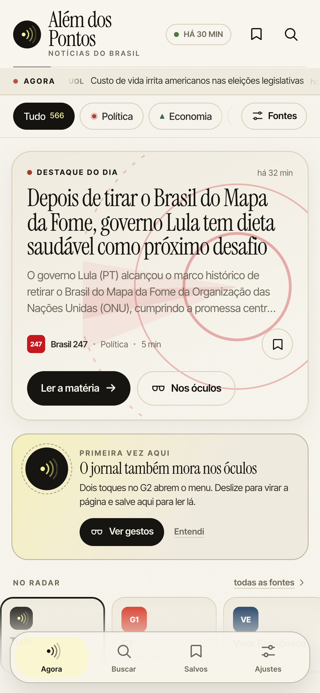

# Além dos Pontos

> **Notícias além do óbvio.**
>
> **Nome na loja e marca:** Além dos Pontos · **repositório e dados:** `farol-noticias`.
> Um leitor editorial para os óculos **Even Realities G2** e para o celular, com 23 veículos brasileiros, busca por voz, favoritos offline e atualização a cada 15 minutos.



<p align="center">
  
  
</p>

## O que é

Além dos Pontos organiza os feeds RSS públicos de **G1, Folha, Valor, InfoMoney, UOL, Crusoé, O Antagonista, Intercept Brasil, Poder360, Metrópoles, Agência Brasil, Brasil de Fato, Veja, Exame, CNN Brasil, Jovem Pan, Nexo, Aos Fatos, Ponte, Alma Preta, Brasil 247, Fórum e DCM** em uma edição única, curada por um robô a cada 15 minutos.

No celular, o app tem uma interface editorial própria (papel, tinta e o amarelo Even) para navegar, filtrar por categoria e fonte, buscar por voz ou teclado, ler a matéria inteira e guardar o que importa. Nos óculos, uma interface em texto de alto contraste, pensada para 576 × 288, com quatro manchetes por tela, paginação por linha e menu de ações por gesto.

O plugin é um app web (Vite + React + TypeScript) que roda no WebView do Even Hub e usa o `@evenrealities/even_hub_sdk` para desenhar nos óculos, persistir favoritos e reagir a toques e deslizes.

## Recursos

- **23 fontes brasileiras** em um só lugar, com diversidade editorial na home (no máximo 2 manchetes por veículo).
- **Edição sempre fresca**: robô no GitHub Actions a cada 15 minutos; o app confere novidades a cada 15 minutos (configurável em 5/15/30 min ou manual).
- **Leitura completa** quando o veículo publica o texto no feed ou permite extração — o robô também tenta o Jina Reader e snapshots públicos do Internet Archive; resumo honesto quando não permite, com link para a versão original.
- **Favoritos offline** guardados no armazenamento do Even Hub, com o texto da matéria junto.
- **Busca local** por título, resumo, fonte e palavras-chave extraídas do texto — sem enviar a pesquisa para servidor nenhum.
- **Busca por voz** quando o WebView expõe reconhecimento de fala; caso contrário, o app orienta o uso do ditado do teclado.
- **Filtros** por categoria (política, economia, mundo, esportes, tecnologia, cultura, cidades, justiça, saúde, ciência) e por fonte, com persistência.
- **Filtro por fonte também nos óculos**, refletido no celular.
- **Gestos no G2**: deslizar para navegar, um toque para abrir, dois toques para o menu; dentro da matéria, um toque abre as ações e deslizar vira a página.
- **Salvar nos óculos** com dois toques → ★ Salvar; o favorito aparece na hora no celular.
- **Atualização manual por gesto** nos óculos: 2 toques → ▶ Atualizar notícias.
- **Interface clara/escura**, tipografia editorial (Instrument Serif + Inter Tight), ilustrações generativas sem imagens remotas.
- **Sem login, sem analytics, sem rastreamento.**

## Idiomas

A interface do Além dos Pontos existe em **português** e **inglês**. O padrão é `Automático`: o app usa `navigator.language`/`navigator.languages` do WebView (o SDK do Even Hub não tem API de idioma do sistema; `UserInfo` só expõe `country`). Se o idioma detectado não for português nem inglês, o app cai em português, o idioma das notícias.

A escolha manual fica em **Ajustes → Idioma** (Automático, Português, English) e também há um atalho **◈ English/Português** no menu dos óculos. A preferência é persistida no armazenamento do Even Hub. As notícias, títulos, resumos e nomes dos veículos permanecem no idioma original — português —; apenas a interface é traduzida.

## Como funciona

```
 feeds RSS ──► GitHub Actions (a cada 15 min) ──► GitHub Pages (JSON estático, CORS *)
                                                        │
                                     ┌──────────────────┴──────────────────┐
                                     │  WebView do Even Hub (este app)     │
                                     │  React + TypeScript                 │
                                     │  ├── celular: UI editorial          │
                                     │  └── óculos: SDK 0.0.16 / 576×288  │
                                     └─────────────────────────────────────┘
```

O webview de um app do Even Hub é um navegador de verdade: CORS vale, e a maioria dos feeds brasileiros não manda `Access-Control-Allow-Origin`. Por isso os dados não são buscados direto do celular: um workflow do GitHub Actions lê os feeds, extrai o texto das matérias, normaliza tudo e publica

- `data/latest.json` — manchetes e metadados (leve, consultado com frequência);
- `data/a/<id>.json` — texto completo de cada matéria (buscado só quando você abre).

O GitHub Pages responde `Access-Control-Allow-Origin: *`, então o app consegue ler o snapshot em qualquer aparelho. O snapshot também é embutido no `.ehpk` como reserva offline.

O robô guarda um arquivo de matérias em cache (GitHub Actions cache) para não reextrair o mesmo texto a cada rodada, mantém 96 horas de edição e limita o volume por veículo. O resultado é auditável: cada matéria tem link, fonte, horário e resumo.

## Fontes

| Veículo | Tipo | Feed |
|---|---|---|
| G1 | Portal | `g1.globo.com/rss/g1/` |
| Valor Econômico | Jornal | `valor.globo.com/rss/valor/` |
| InfoMoney | Portal | `infomoney.com.br/feed/` |
| Folha de S.Paulo | Jornal | `feeds.folha.uol.com.br/emcimadahora/rss091.xml` |
| UOL Notícias | Portal | `rss.uol.com.br/feed/noticias.xml` |
| O Antagonista | Revista | `oantagonista.com.br/feed/` |
| Crusoé | Revista | `crusoe.com.br/feed/` |
| Intercept Brasil | Revista | `intercept.com.br/feed/` |
| Poder360 | Portal | `poder360.com.br/feed/` |
| Metrópoles | Portal | `metropoles.com/feed` |
| Agência Brasil | Agência | `agenciabrasil.ebc.com.br/rss/ultimasnoticias/feed.xml` |
| Brasil de Fato | Jornal | `brasildefato.com.br/feed/` |
| Veja | Revista | `veja.abril.com.br/feed/` |
| Exame | Revista | `exame.com/feed/` |
| CNN Brasil | Portal | `cnnbrasil.com.br/feed/` |
| Jovem Pan | Portal | `jovempan.com.br/feed/` |
| Nexo Jornal | Jornal | `nexojornal.com.br/rss.xml` |
| Aos Fatos | Agência | `aosfatos.org/noticias/feed/` |
| Ponte Jornalismo | Revista | `ponte.org/feed/` |
| Alma Preta | Portal | `almapreta.com.br/feed/` |
| Brasil 247 | Portal | `brasil247.com/feed/` |
| Revista Fórum | Revista | `revistaforum.com.br/feed/` |
| Diário do Centro do Mundo | Portal | `diariodocentrodomundo.com.br/feed/` |

> As notícias pertencem aos veículos que as publicam. Além dos Pontos apenas organiza os feeds públicos, indica a fonte e leva ao original. Para pedir a remoção de um conteúdo, abra uma issue.

## Gestos nos óculos

| Gesto | Na lista | Lendo uma matéria | No menu |
|---|---|---|---|
| Deslizar ▲ ▼ | rolar a lista nativa | virar página | rolar o menu |
| 1 toque | abrir a matéria | abrir ações | escolher a ação |
| 2 toques | abrir o menu | abrir ações | voltar |

No menu: **▶ Atualizar notícias**, **▷ Filtrar por fonte**, **★ Matérias salvas**, **◈ Como usar** e **× Sair do Além dos Pontos**. O rodapé mostra a página atual, uma barra de progresso e a dica de gesto.

## Rodando localmente

Pré-requisitos: **Node.js 22+** e npm.

```bash
npm install
npm run dev          # http://localhost:5173
npm run simulate     # abre o simulador do Even Hub nesta URL
```

Para testar no seu G2, com o computador e os óculos na mesma rede:

```bash
npx evenhub qr --url http://<seu-ip>:5173
```

Escaneie o QR pelo app do Even Hub.

### Dados locais

O app usa o snapshot publicado no GitHub Pages por padrão. Para gerar/atualizar um snapshot local em `public/data` (usado como fallback offline e durante o desenvolvimento):

```bash
npm run news         # gera ./dist (snapshot completo)
npm run snapshot     # copia o snapshot para public/data
```

O snapshot local é ignorado pelo git; ele entra no build do `.ehpk` como reserva.

### Build e empacotamento

```bash
npm run build
npm run pack         # gera farol-noticias.ehpk
# ou manualmente:
npx evenhub pack app.json dist -o farol-noticias.ehpk
```

O `.ehpk` é o arquivo que se envia ao Even Hub. Veja [STORE.md](STORE.md) para os textos prontos de cada campo do formulário.

## Estrutura

```
aggregator/
  index.mjs          robô de coleta, extração e publicação
  sources.mjs        catálogo de veículos, feeders e palavras-chave
.github/workflows/
  news.yml           cron de 15 min → GitHub Pages
src/
  App.tsx            orquestra estado, leitura, filtros, óculos e sessão
  components/        UI do celular (hero, feed, leitor, busca, salvos, ajustes)
  lib/
    api.ts           snapshots remoto/local + cache
    bridge.ts        detecção do host Even e acesso ao SDK
    storage.ts       persistência em chunks no armazenamento do Even Hub
    glasses.ts       páginas, listas, paginação e eventos do G2
    paginate.ts      paginação por linha com as métricas do firmware
    useVoiceSearch.ts busca por voz com fallback
    time.ts          datas em pt-BR
  data/meta.ts       categorias, cores e monogramas das fontes
store/               ícone, capturas e textos de publicação
```

## Privacidade

Sem conta, sem cookies de rastreamento, sem analytics. O app baixa um JSON público, guarda favoritos e ajustes no armazenamento local do Even Hub e faz a busca dentro do próprio aparelho. Leia a política completa em [PRIVACY.md](PRIVACY.md) ou em <https://andrebadini.github.io/farol-noticias/privacy.html>.

## Créditos

- [Even Realities — everything-evenhub](https://github.com/even-realities/everything-evenhub) (skills de design, SDK, simulador)
- [evenhub-templates](https://github.com/even-realities/evenhub-templates) (padrões de paginação e ciclo de página)
- [`@evenrealities/pretext`](https://www.npmjs.com/package/@evenrealities/pretext) (métricas de fonte do G2)
- [Instrument Serif](https://fonts.google.com/specimen/Instrument+Serif) e [Inter Tight](https://fonts.google.com/specimen/Inter+Tight) via Fontsource (OFL)
- [`@extractus/article-extractor`](https://github.com/extractus/article-extractor), `html-to-text`, `fast-xml-parser`

## Licença

Código sob [MIT](LICENSE). O conteúdo jornalístico continua sendo dos veículos originais.
